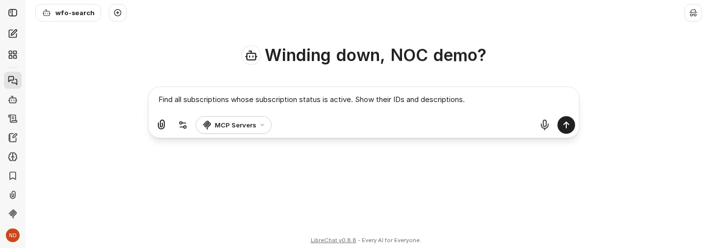
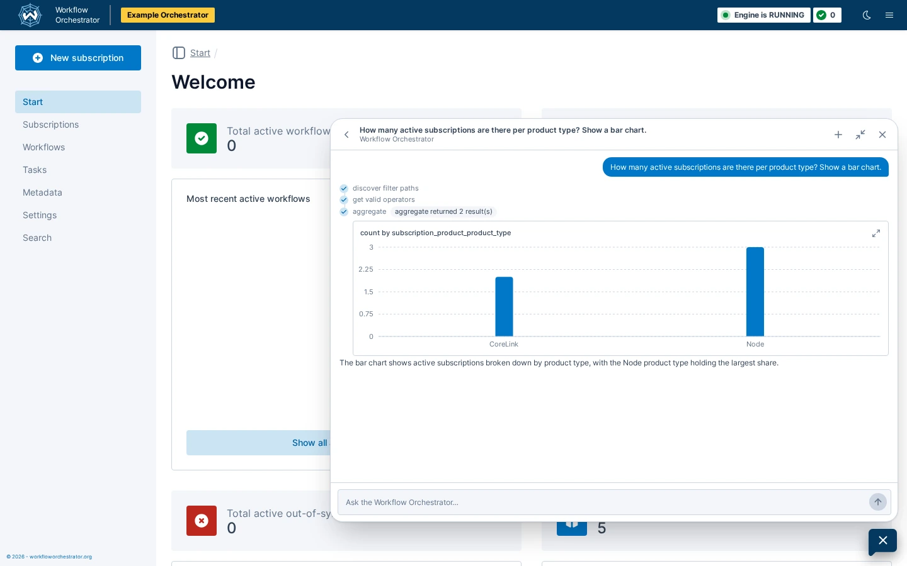
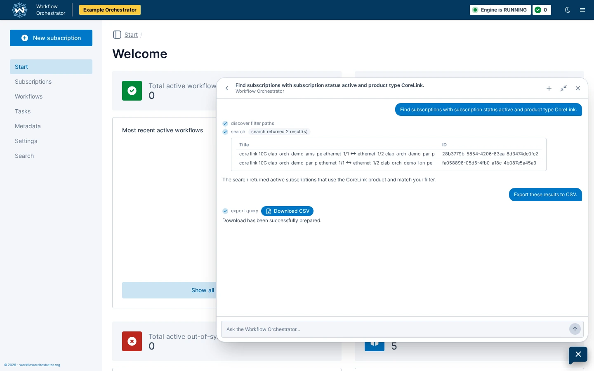
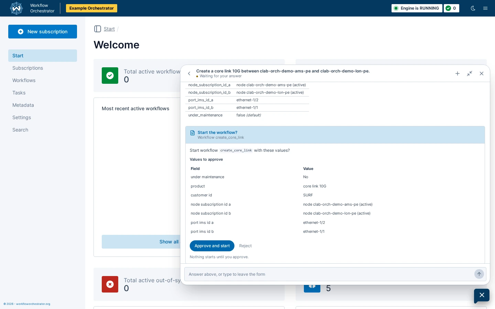
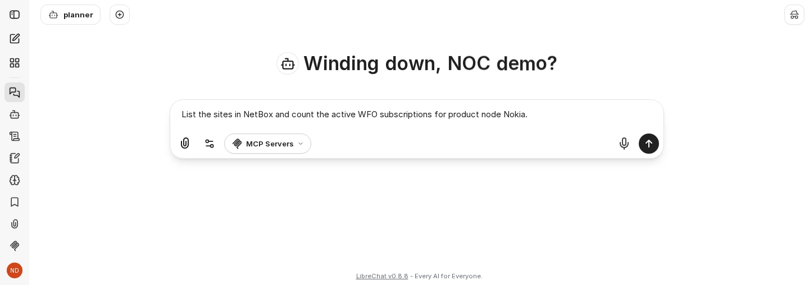
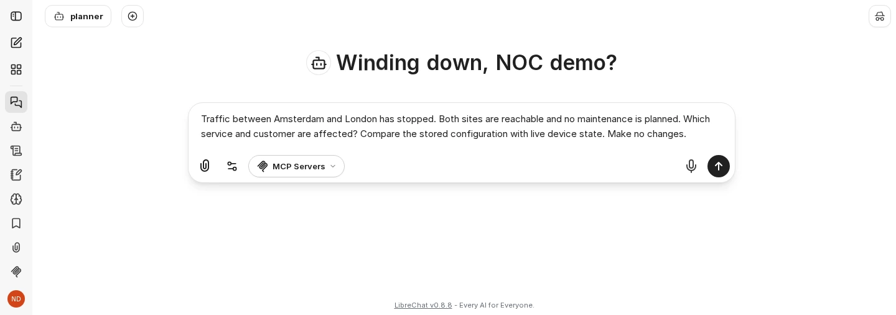

# Orchestrator Agent: from first question to production

The [Orchestrator Agent](https://github.com/workfloworchestrator/orchestrator-agent) lets people and other agents work
with your WFO in plain language: search and count subscriptions, look up details, export results and start workflows.
It is a ready-to-use agent built on the tools that the
[MCP server](../../orchestrator-core/reference-docs/mcp.md) of Orchestrator Core exposes.

This page follows the questions you have along the way, from knowing nothing about the agent to running it live. See
what it can do, try it on the example orchestrator, learn what data it touches, apply it to your own stack, deploy it
and keep it working. Each section is short and points to the tutorial, the guides and the reference that go into
detail.

## What can I do with it?

The use cases below are based on the
[example orchestrator](https://github.com/workfloworchestrator/example-orchestrator). **The pills identify the protocol
used in each example**, explained under [How can I reach the agent?](#how-can-i-reach-the-agent). Each use-case page
explains other ways to try it and any client-specific requirements.

**The examples need different amounts of setup.** Search and Multi-agent work with only the
[example orchestrator tutorial](tutorials/example-orchestrator.md). Aggregate and charts, Export and Start workflows
from chat are shown in the agent chat popup, which the tutorial does not install: add it with
[Add the agent chat to the WFO UI or your portal](../../orchestrator-agent/guides/chat-popup.md). Outage triage
also needs the network demo lab of the example orchestrator.

-   **[Search](use-cases/search.md){ .wfo-card-link }**

    Chat

    *"Find all subscriptions whose subscription status is active."*

    Matching subscriptions, ranked by relevance.

    { .off-glb .wfo-card-chat }

-   **[Aggregate and charts](use-cases/aggregate-and-charts.md){ .wfo-card-link }**

    AG-UI

    *"How many active subscriptions are there per product type?"*

    Counts and trends, ready to chart.

    { .off-glb .wfo-card-popup }

-   **[Export](use-cases/export.md){ .wfo-card-link }**

    AG-UI

    *"Export all active core links to CSV"*

    A downloadable file with the results.

    { .off-glb .wfo-card-popup }

-   **[Start workflows from chat](use-cases/workflows-from-chat.md){ .wfo-card-link }**

    AG-UI

    *"Create a core link between Amsterdam and London"*

    Review the workflow and its values before approving it.

    { .off-glb .wfo-card-popup .wfo-card-popup--approval }

-   **[Multi-agent: WFO + NetBox](use-cases/multi-agent-netbox.md){ .wfo-card-link }**

    A2A

    *"List NetBox sites and count active node Nokia subscriptions in WFO."*

    One answer combining several systems.

    { .off-glb .wfo-card-chat }

-   **[Outage triage](use-cases/outage-triage.md){ .wfo-card-link }**

    A2A

    *"Why is Amsterdam–London traffic down, and which customer is affected?"*

    A planner combines WFO, NetBox and live network evidence to investigate an outage without making changes.

    { .off-glb .wfo-card-chat }

### How can I reach the agent?

The agent is reachable in several ways, so you can fit it into your own agentic setup:

Chat **OpenAI chat completions**: use it as a chat model
in LibreChat or any other OpenAI-compatible client. See [Connect LibreChat](../../orchestrator-agent/guides/librechat.md).

A2A **A2A**: let other agents, such as a planner, hand
questions and tasks to it. See [Connect another agent over A2A](../../orchestrator-agent/guides/a2a-planner.md).

AG-UI **AG-UI**: stream answers, tables and charts into a chat
popup in the WFO UI or your own web frontend. See
[Add the agent chat to the WFO UI or your portal](../../orchestrator-agent/guides/chat-popup.md).

MCP **MCP**: call it as a tool from MCP clients such as Claude
Code or an agent framework. See [Use the agent with MCP](../../orchestrator-agent/guides/mcp-clients.md).

## How can I try it out myself?

Follow the [tutorial](tutorials/example-orchestrator.md). It runs the agent, a planner and a NetBox agent on the example
orchestrator, with LibreChat as the chat frontend. You search subscriptions, ask one question across WFO and NetBox
and start a workflow after approving it. You only need the example orchestrator and an API key for an LLM provider.

The examples that use the AG-UI popup (charts, export and the workflow review) need the chat popup as well, see
[Add the agent chat to the WFO UI or your portal](../../orchestrator-agent/guides/chat-popup.md). Outage triage has its
own setup, described on its page.

## How does it work, and what data does the agent touch?

- [How the agent fits on top of Orchestrator Core](../../orchestrator-agent/explanation/index.md): how Core, the model, the database
  and different clients work together.
- [The language model](../../orchestrator-agent/explanation/index.md#the-language-model-interprets-the-request) and
  [conversation storage](../../orchestrator-agent/explanation/index.md#the-database-stores-the-conversations):
  where requests are processed and why the agent needs database access.
- [The agent needs approval before starting workflows](../../orchestrator-agent/explanation/index.md#the-agent-needs-approval-before-starting-workflows): how
  interpreting a request is kept separate from authorising a change.

## How can I apply it to my own stack?

- [Getting started](../../orchestrator-agent/getting-started.md): run the agent on your own Orchestrator Core. See
  the [prerequisites](../../orchestrator-agent/getting-started.md#prerequisites) for what it needs.
- Connect your clients: [LibreChat](../../orchestrator-agent/guides/librechat.md),
  [MCP clients](../../orchestrator-agent/guides/mcp-clients.md),
  [an A2A planner](../../orchestrator-agent/guides/a2a-planner.md) or
  [the chat popup in the WFO UI or your portal](../../orchestrator-agent/guides/chat-popup.md).
- Fit it to your data: [Add domain context](../../orchestrator-agent/guides/domain-context.md),
  [Expose your own Core routes as tools](../../orchestrator-core/reference-docs/mcp.md#extending),
  [Connect another system through a planner](integrations/connect-service.md),
  [Run a companion agent with docker-agent](integrations/create-agent.md) and
  [Enable AI search and embeddings](../../orchestrator-core/reference-docs/ai-search.md#running-it).
- Choose your model: [Change the language model](../../orchestrator-agent/guides/own-llm.md).
- Look up the details in the reference:
  [Endpoints and protocols](../../orchestrator-agent/reference/endpoints.md) and
  [Configuration](../../orchestrator-agent/reference/configuration.md).

## How do I deploy it live?

- [Running the agent in your own stack](production.md): the choices for
  production, such as which clients connect, who they act as, where the agent runs, which model it uses and what you put
  around it.
- [How to configure authentication and authorization](../../orchestrator-agent/guides/secure-agent.md): authenticate users, authorize them with OPA and
  call Orchestrator Core as them. [Authentication and authorization](../../orchestrator-agent/explanation/auth.md)
  explains which token reaches Orchestrator Core on which endpoint.
- [Gateways](production.md#gateways): once several clients, other agents or machine callers reach the agent, decide in
  one place, in front of it, who may call it, what they may see and how much they may spend.

## How do I keep it working?

- [Understanding agent evaluations](../../orchestrator-agent/explanation/evaluation.md): why prompt and model changes need
  a benchmark.
- [How to benchmark prompt and model changes](../../orchestrator-agent/guides/evals.md): run the evals before you change a
  prompt or a model, and gate CI on them.
- [How to add an evaluation case](../../orchestrator-agent/guides/add-eval-case.md): protect a request or observed failure
  with checks in the dataset.
- [How to trace the agent](../../orchestrator-agent/guides/tracing.md): follow requests and costs in Langfuse or another
  OpenTelemetry backend. [Tracing and observability](../../orchestrator-agent/explanation/observability.md) explains what
  traces show and how they feed the evals.
