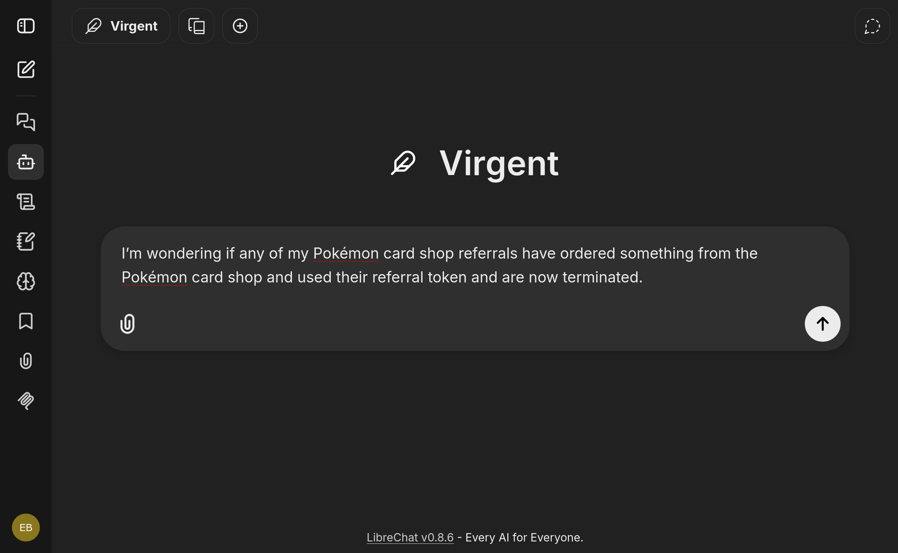

# What the agent can do

<!-- OUTLINE: 2-line intro (ask questions about your subscriptions, products and workflows in plain language) + hero screenshot of LibreChat with a WFO answer -->

<!-- OUTLINE: status legend. "Available" = on orchestrator-agent main / in a release. "In development" = branch only. -->

## Use cases

<!-- OUTLINE: one card per use case: thumbnail · example question · what you get · status badge · links: Tutorial step | How-to | Reference | Virge.io showcase -->

-   **Search**

    *"Which L2VPNs run on node X?"*

    Matching subscriptions, ranked by relevance.

    - [How-to: Enable AI search](#)
    - [Reference: Plugins](#)
    - [Virge.io showcase](#)

    

-   **Aggregate and charts**

    *"How many subscriptions per product, per month?"*

    Counts and trends, ready to chart.

    - [Reference: Plugins](#)
    - [Virge.io showcase](#)

    

-   **Look up by id**

    *"Show subscription 3f2a…"*

    The full details of a single subscription.

    - [Reference: Plugins](#)

    

-   **Export**

    *"Export all active core links to CSV"*

    A downloadable file with the results.

    - [Reference: Plugins](#)
    - [Virge.io showcase](#)

    

-   **Start workflows from chat**

    *"Create a core link between Amsterdam and London"*

    A workflow started from the conversation.

    - [How-to: Start workflows from chat](#)
    - [Reference: Plugins](#)
    - [Virge.io showcase](#)

    

-   **Multi-agent: WFO + NetBox**

    *"Which sites exist in NetBox, and how many nodes are in WFO?"*

    One answer combining several systems.

    - [How-to: Multi-agent over A2A](#)
    - [Virge.io showcase](#)

    

-   **Use your own LLM**

    *"Compare models on your own data"*

    Model results side by side on your own questions.

    - [How-to: Use your own LLM](#)
    - [How-to: Benchmark prompt and model changes](#)

    

-   **Result tables in chat**

    *"Browse, select and send results back to the agent"*

    Interactive tables inside the chat.

    

## Where to start

<!-- OUTLINE: link to the tutorial below, and to Projects / Orchestrator Agent for installation, guides and reference -->

## WFO beyond networking

<!-- OUTLINE: short note that WFO is domain-agnostic (see At A Glance) + neutral list of community write-ups of non-network uses -->
