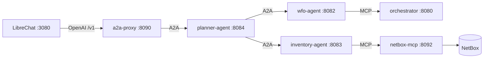

# Run the agent on the example orchestrator

In this tutorial you start the agents profile of the example orchestrator: LibreChat as the chat frontend, a planner
agent, an inventory agent for NetBox and the Orchestrator Agent. Then you ask it questions about the data of the
orchestrator. It continues from the [Example Orchestrator Workshop](../../workshops/example-orchestrator/overview.md).



## Prerequisites

- You finished [Getting started](../../workshops/example-orchestrator/bootstrap.md) and
  [Seeding data](../../workshops/example-orchestrator/execute-workflows.md) of the workshop, so that the example
  orchestrator runs and contains nodes and core links.
- An API key for an LLM provider. The default model is `openai:gpt-5-mini`.

## 1. Add your LLM key

Create a `.env` file next to `docker-compose.yml` of the example orchestrator:

```shell
AGENT_MODEL=openai:gpt-5-mini
AGENT_API_KEY=sk-...
```

`AGENT_MODEL` is a [pydantic-ai model string](https://ai.pydantic.dev/models/) in `provider:model` format, used by the
Orchestrator Agent. The two other agents declare their model in their own `agent.yaml` and read the same
`AGENT_API_KEY`. For another provider, see [Use your own LLM](../../orchestrator-agent/guides/own-llm.md).

## 2. Start the agents profile

The agent services are gated behind the `agents` profile, so the base stack is unchanged when you do not start them:

```shell
export COMPOSE_PROFILES=agents
docker compose up -d
```

This adds the services below to the stack.

| Service | Role |
| --- | --- |
| `librechat`, `mongodb` | The chat frontend and its conversation store |
| `a2a-proxy` | Exposes the A2A agents as OpenAI-compatible models, because LibreChat has no A2A client |
| `planner-agent` | Splits a question up and delegates to the other two agents over A2A |
| `wfo-agent` | The Orchestrator Agent. All its tools come from the MCP server of the orchestrator |
| `inventory-agent` | Reads NetBox through `netbox-mcp` |

The orchestrator needs no extra service, because Orchestrator Core has a built-in MCP server. It is enabled with
`MCP_ENABLED=True` in the stack and served at `http://localhost:8080/mcp`.

## 3. Seed data

The agents are only interesting when there is something to find. If you have not yet done so, run the **NetBox
Bootstrap** task and the node and port workflows from the workshop, see
[Seeding data](../../workshops/example-orchestrator/execute-workflows.md). For the answers of the inventory agent, NetBox must
contain devices.

## 4. Open LibreChat

Open <http://localhost:3080> and register a local account, which is stored in your own `mongodb` container. Pick a
model under **WFO Agents**:

- **planner**, the default, for questions that span systems.
- **wfo-search** or **inventory**, to talk to one agent and see what it contributes.

## 5. Try these prompts

Start with **wfo-search** and then try the planner.

!!! example "Search"
    *Which subscriptions are active?*

    The agent searches the index and shows a table of the matching subscriptions.

!!! example "Aggregate and chart"
    *How many subscriptions are there per product?*

    A grouped count is rendered as a chart. A count without grouping is a number.

!!! example "Look up by id"
    *Show subscription* followed by the id, or the start of it, of one of the subscriptions from the table.

    You get the details of that subscription. If the start of the id matches several, you are asked to pick one.

!!! example "Export"
    *Export these subscriptions to CSV*

    A follow-up on the previous search that returns a download link.

!!! example "Start a workflow"
    *Create a node*, or *Terminate subscription* followed by an id.

    The agent picks the workflow and asks the questions of its form. At the end you see the exact call and approve
    it. Nothing starts before you approve. See [Start workflows from chat](../../orchestrator-agent/guides/workflows-from-chat.md).

!!! example "Across systems, with the planner"
    *Which sites exist in NetBox, and how many nodes does the orchestrator have?*

    The planner delegates to both agents and combines their answers into one.

## Troubleshooting

**No results, or poor results.** The search index may be empty, or embeddings are not enabled. Without embeddings the
agent uses fuzzy search only. See
[Enable AI search and embeddings](../../orchestrator-agent/guides/ai-search.md).

**Errors from the model.** Check `AGENT_MODEL` and `AGENT_API_KEY` in the `.env` file, and look at
`docker compose logs wfo-agent`.

**The planner cannot reach an agent.** An agent card captures the container address at startup. If you restarted
`inventory-agent` or `wfo-agent` on its own, restart `planner-agent` afterwards so that it finds its peers again.

**The agent does not start.** At startup the agent checks the tools of the MCP server of the orchestrator, so it
stops when the orchestrator is not healthy yet. It restarts automatically, and it should come up when the
orchestrator has started.

## Next steps

- [Run the agent on your own Orchestrator Core](../../orchestrator-agent/getting-started.md)
- [Guides](../../orchestrator-agent/guides/librechat.md) to connect other clients and configure the agent
- [What the agent can do](index.md)
