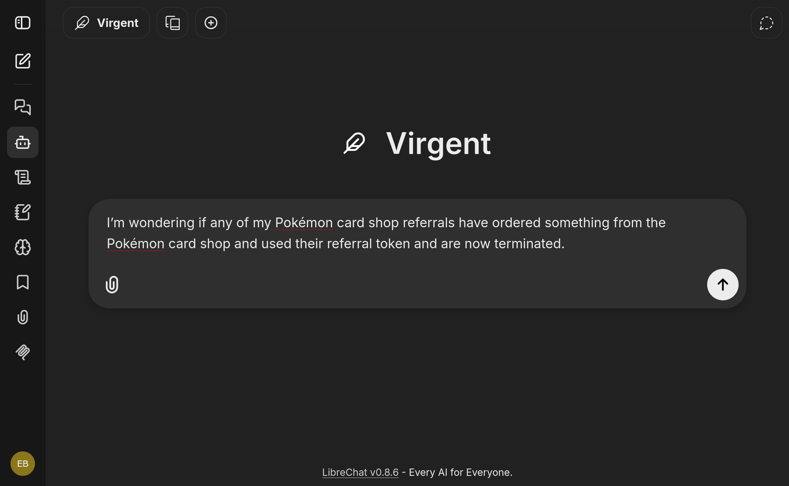

# Run the agent on the example orchestrator

In this tutorial we add the Orchestrator Agent to the example orchestrator and talk to it from a chat window. It has
three parts:

1. **Set up** the agent next to the example orchestrator.
2. **Ask questions**: we start with one prompt, then you try the others in your own words.
3. **Change something**: create a core link from the chat and approve it.

It takes about 30 minutes and continues from the
[Example Orchestrator Workshop](../../../workshops/example-orchestrator/overview.md).

## Before you start

- You have done [Getting started](../../../workshops/example-orchestrator/bootstrap.md) and
  [Seeding data](../../../workshops/example-orchestrator/execute-workflows.md) of the workshop. The orchestrator
  runs, NetBox is bootstrapped, the three nodes exist and so does the first core link, between
  `clab-orch-demo-ams-pe` and `clab-orch-demo-par-p`. We create the second core link in part 3.
- You have an OpenAI API key.

## Part 1: Set up the agent

### 1. Add your API key

In the directory of the example orchestrator, next to `docker-compose.yml`, create a file named `.env`:

```shell
AGENT_MODEL=openai:gpt-5-mini
AGENT_API_KEY=sk-...
```

Replace `sk-...` with your key.

### 2. Start the agents

```shell
export COMPOSE_PROFILES=agents
docker compose up -d
```

Docker starts LibreChat, the Orchestrator Agent and two more agents next to the stack you already have. The agent
waits for the orchestrator, so give it a minute. Then check that it is up:

```shell
curl -f http://localhost:8082/health
```

If curl reports an error, wait a little longer and try again.

### 3. Open LibreChat

1. Open <http://localhost:3080> and click **Sign up**. The account only exists in your local stack.
2. Open the model menu at the top of the chat, and under **WFO Agents** select **wfo-search**.

**wfo-search** is the Orchestrator Agent on its own. We switch to the planner in part 2.

## Part 2: Ask the agent questions

Type:

```text
Which subscriptions are active?
```

The agent answers with a table of subscriptions: the nodes and the core link you created in the workshop.



Notice that you did not say where to look or how. The agent chose to search the orchestrator for you.

### Try these yourself

Now ask more. You do not need to follow this order or use these exact words: the agent decides which tool it needs.
Open an example to see a prompt to start from and what to expect.

??? example "Look up a subscription"

    Copy the first eight characters of a subscription id from the table above, then type, with your own id:

    ```text
    Show subscription 3f2a9c1e
    ```

    The agent shows the details of that subscription: its product, status and the values of its fields.

    

??? example "Export to CSV"

    ```text
    Export the active subscriptions to CSV
    ```

    The agent answers with a download link. Click it and open the file: it holds the active subscriptions.

    

??? example "Make a chart"

    ```text
    How many subscriptions are there per product?
    ```

    The answer is a chart, with one bar per product.

    

??? example "Ask across systems"

    Open the model menu and select **planner**. Then type:

    ```text
    Which sites exist in NetBox, and how many nodes does the orchestrator have?
    ```

    The answer combines both: the sites Amsterdam, London and Paris from NetBox, and three nodes from the
    orchestrator.

    Notice that the planner did not answer on its own. It asked the inventory agent about NetBox and the
    Orchestrator Agent about the orchestrator, then put the two answers together.

    

The answers of a language model are worded differently each time, so yours will not match the screenshots word for
word. The tables, the chart and the links are the same.

Select **wfo-search** again before you continue.

## Part 3: Change something

So far the agent only read data. Now we let it change something. In the workshop topology `clab-orch-demo-par-p`
port `1/1` is cabled to `clab-orch-demo-lon-pe` port `1/2`, and there is no core link for it yet. Type:

```text
Create a core link 10G between clab-orch-demo-par-p and clab-orch-demo-lon-pe
```

The agent picks the workflow and asks the questions of its form, one at a time. Answer them as follows:

| Question | Answer |
| --- | --- |
| Customer | SURF |
| Node A | `clab-orch-demo-par-p` |
| Port on node A | `1/1` |
| Node B | `clab-orch-demo-lon-pe` |
| Port on node B | `1/2` |
| Under maintenance | No |

You can also answer with the keyboard; see
[Start workflows from chat](../use-cases/workflows-from-chat.md#what-the-user-goes-through).

When the form is complete, the agent shows the workflow it will start and every value you gave. Click **Approve**.


Notice that nothing started before you clicked. Typing *yes* in the chat would not have been enough.

The agent answers with the id of the new process. Open the orchestrator at <http://localhost:3000>, go to
**Workflows** and open the process. As in the workshop, it pauses at **Confirm provisioning proxy results**. Click
**Resume workflow** and wait until it completes.

## What you have done

You started the Orchestrator Agent next to the example orchestrator and, from one chat window, you searched,
looked up, exported and charted subscriptions, asked one question that a planner answered with two agents, and
created a core link that ran only after your approval.

Here is what was going on behind the chat window:

- **Tools.** Each answer came from a plugin: `search`, `entity`, `export`, `aggregate` and `workflow`. See
  [Plugins](../../../orchestrator-agent/reference/plugins.md).
- **Protocols.** LibreChat talked to the agent over
  [OpenAI chat completions](../../../orchestrator-agent/reference/endpoints.md#openai-chat-completions), and the
  planner reached the agents over [A2A](../../../orchestrator-agent/reference/endpoints.md#a2a). The same agent also
  speaks [AG-UI](../../../orchestrator-agent/reference/endpoints.md#ag-ui) and
  [MCP](../../../orchestrator-agent/reference/endpoints.md#mcp), so other clients can use it too.
- **Approval.** The agent only starts a workflow after you approve it; see
  [The agent needs approval before starting workflows](../../../orchestrator-agent/architecture/index.md#the-agent-needs-approval-before-starting-workflows).
- **Configuration.** `AGENT_MODEL` and `AGENT_API_KEY` are two of the
  [configuration](../../../orchestrator-agent/reference/configuration.md) settings.

## If something does not work

**The agent finds nothing.** Check that you did the workshop's *Seeding data*. If the agent still finds little, the
search index may be empty or embeddings may be off; see
[Enable AI search and embeddings](../../../orchestrator-core/reference-docs/ai-search.md#running-it).

**The model returns an error.** Check `AGENT_MODEL` and `AGENT_API_KEY` in `.env`, and run
`docker compose logs wfo-agent`.

**The planner cannot reach an agent.** If you restarted `wfo-agent` or `inventory-agent` on its own, run
`docker compose restart planner-agent`.

## Next steps

- [How the agent fits on top of Orchestrator Core](../../../orchestrator-agent/architecture/index.md): what the services you just
  started are and how they talk to each other
- [Run the agent on your own Orchestrator Core](../../../orchestrator-agent/getting-started.md)
- [Start workflows from chat](../use-cases/workflows-from-chat.md) and the other
  [guides](../../../orchestrator-agent/guides/librechat.md), to connect other clients and configure the agent
- [Orchestrator Agent: from first question to production](../index.md)
