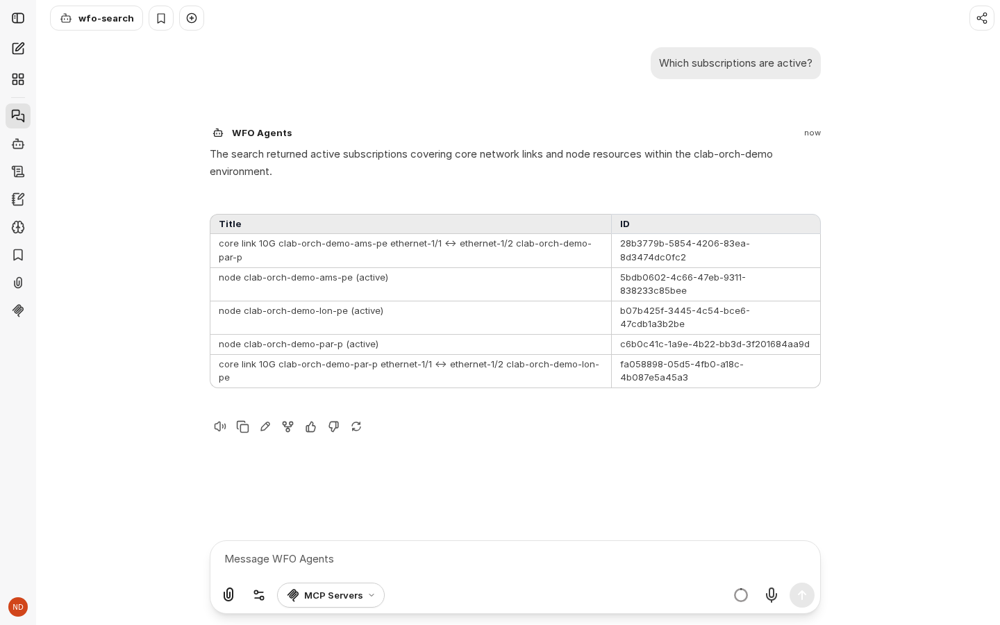
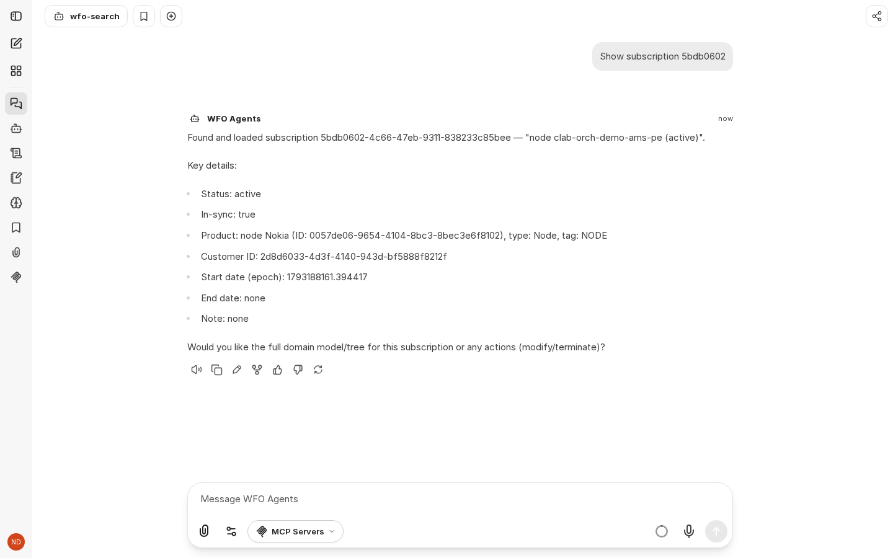
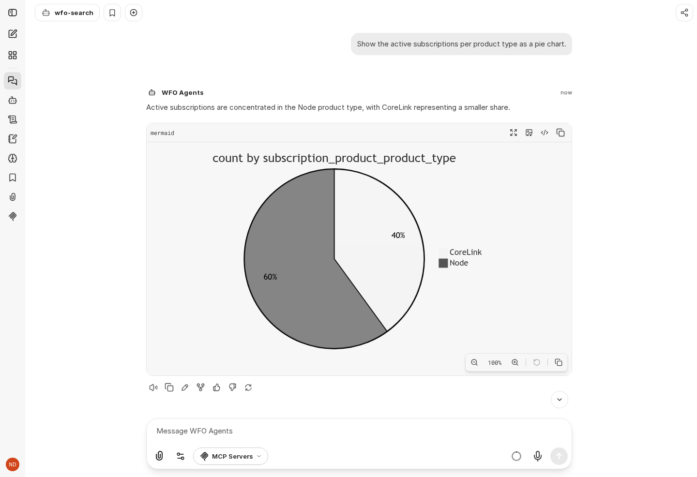
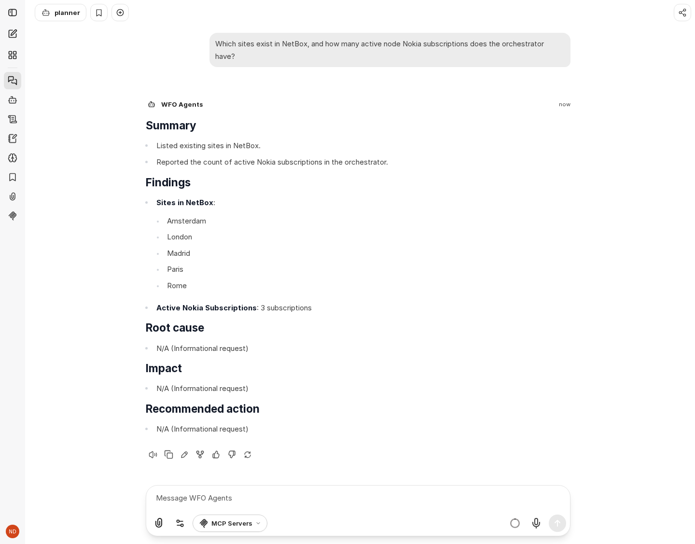
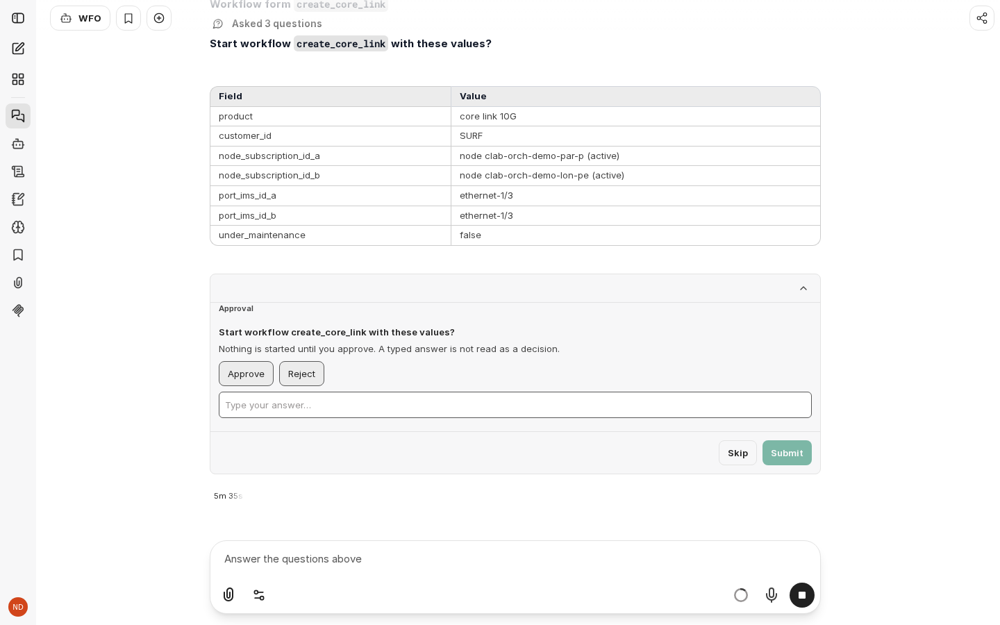

# Tutorial: add the agent to the example orchestrator

This tutorial adds the Orchestrator Agent to the example orchestrator and lets you talk to it from a chat window. It has
four parts:

1. **Set up** the agent next to the example orchestrator.
2. **Ask questions**: start with one prompt, then try the others in your own words.
3. **Change something**: create a core link from the chat and approve it.
4. **Explore inside WFO**: use the native AG-UI popup for charts, CSV downloads and saved chats (optional).

It takes about 30 minutes, excluding the prerequisite workshop, and continues from the
[Example Orchestrator Workshop](../../../workshops/example-orchestrator/overview.md).

## Before you start

- You have done [Getting started](../../../workshops/example-orchestrator/bootstrap.md) and
  [Seeding data](../../../workshops/example-orchestrator/execute-workflows.md) of the workshop. The orchestrator
  runs, NetBox is bootstrapped, the three nodes exist and so does the first core link, between
  `clab-orch-demo-ams-pe` and `clab-orch-demo-par-p`.
- You have an OpenAI API key.
- Your example-orchestrator checkout includes the **WFO (HITL)** model in
  `docker/librechat/librechat.yaml` and the compatible versions in its Compose files:
  Orchestrator Agent **0.5.1**, Core **5.7.0a3** and LibreChat **0.8.8**.
  If it does not, update your checkout before continuing.

Core 5.7.0a3 is an alpha release required by this agent's workflow-form API. Use a disposable workshop database;
the example applies database migrations when it starts.

## Part 1: Set up the agent

### 1. Add your API key

In the directory of the example orchestrator, next to `docker-compose.yml`, create a file named `.env`:

```shell
AGENT_MODEL=openai:gpt-5-mini
AGENT_API_KEY=sk-...
```

Replace `sk-...` with your key.

The planner and inventory agent also use this OpenAI key. `AGENT_MODEL` changes only the Orchestrator Agent;
the other agents declare their models in their own `agent.yaml` files.

### 2. Start the agents

```shell
source .env.workshop
export COMPOSE_PROFILES=lso,agents
docker compose up -d
```

Docker starts LibreChat, the Orchestrator Agent and two more agents next to the stack you already have. The agent
waits for the orchestrator, so give it a minute. Then check that it is up:

```shell
curl -f http://localhost:8082/health
```

If curl reports an error, wait a little longer and try again.

Run the same startup commands in a fresh terminal or after stopping the stack. Sourcing `.env.workshop` keeps
`LSO_ENABLED=True`; enabling both profiles retains the workshop's provisioning service for Part 3.

### 3. Open LibreChat

1. Open <http://localhost:3080> and click **Sign up**. The account only exists in your local stack.
2. Open the model menu at the top of the chat and select **WFO (HITL)**.

**WFO (HITL)** connects directly to the Orchestrator Agent and supports workflow forms. Part 2 also tries the planner.

## Part 2: Ask the agent questions

Type:

```text
Which subscriptions are active?
```

The agent answers with a table of subscriptions: the nodes and the core link you created in the workshop.

<div class="wfo-use-case-scene" markdown>

[](../../../img/orchestrator-agent/tutorial/active-subscriptions.png)

</div>

The screenshots use a lab with three nodes and two core links. Your workshop starts with one core link, so your
list and counts will differ.

Notice that you did not say where to look or how. The agent chose to search the orchestrator for you.

### Try these yourself

Now ask more. You do not need to follow this order or use these exact words: the agent decides which tool it needs.
Open an example to see a prompt to start from and what to expect.

??? example "Look up a subscription"

    Copy the first eight characters of a subscription id from the table above, then type, with your own id:

    ```text
    Show subscription 5bdb0602
    ```

    The agent shows the details of that subscription: its product, status and the values of its fields.

    <div class="wfo-use-case-scene" markdown>

    [](../../../img/orchestrator-agent/tutorial/subscription-details.png)

    </div>

??? example "Chart per product type"

    ```text
    Show the active subscriptions per product type as a pie chart.
    ```

    The agent counts the active subscriptions per product type and draws the result as a pie: three nodes and
    two core links in the screenshot. Ask for a bar chart instead and you get one, but with only a few
    categories a pie shows the split more clearly. Presentation depends on the client. Try the native AG-UI chart renderer in [Part 4](#part-4-explore-the-agent-inside-the-wfo-ui).

    <div class="wfo-use-case-scene" markdown>

    [](../../../img/orchestrator-agent/tutorial/subscriptions-per-product.png)

    </div>

??? example "Ask across systems"

    Start a new chat, open the model menu and select **WFO Agents → planner**. Then type:

    ```text
    Which sites exist in NetBox, and how many active subscriptions does the orchestrator have for the product named "node Nokia"?
    ```

    The answer combines both: the five sites Amsterdam, Paris, London, Madrid and Rome from NetBox, and three
    nodes from the orchestrator.

    The planner does not answer on its own. Behind the scenes it asks the inventory agent about NetBox and the
    Orchestrator Agent about the orchestrator, then puts the two answers together. The chat only shows the
    combined answer.

    <div class="wfo-use-case-scene" markdown>

    [](../../../img/orchestrator-agent/tutorial/sites-and-nodes.png)

    </div>

The answers of a language model are worded differently each time, so yours will not match the screenshots word for
word. Check the results against the subscriptions in your own lab.

## Part 3: Change something

Start a new chat and select **WFO (HITL)** again. The example stack includes the direct connection and form settings;
the planner's A2A proxy route is for the cross-system question above. For another stack, see
[Connect LibreChat](../../../orchestrator-agent/guides/librechat.md).

So far the agent only read data. Now let it change something. In the workshop topology `clab-orch-demo-par-p`
port `ethernet-1/1` is cabled to `clab-orch-demo-lon-pe` port `ethernet-1/2`, and there is no core link for it yet. Type:

```text
Create a core link 10G between clab-orch-demo-par-p and clab-orch-demo-lon-pe
```

The agent picks the workflow and asks the questions of its form, one at a time. Answer them as follows:

| Question | Answer |
| --- | --- |
| Product | core link 10G |
| Customer | SURF |
| Node A | `clab-orch-demo-par-p` |
| Node B | `clab-orch-demo-lon-pe` |
| Port on node A | `ethernet-1/1` |
| Port on node B | `ethernet-1/2` |
| Maintenance | False (or **Keep default**) |

When the form is complete, the agent shows the workflow it will start and every value you gave. Select **Approve**,
then click **Submit**.

<div class="wfo-use-case-scene" markdown>

[](../../../img/orchestrator-agent/tutorial/workflow-approval.png)

</div>

The recording lab already has the Paris–London link, so this pending form uses free port `ethernet-1/3` on both
nodes. In your workshop, use the cabled ports in the table above. The screenshot was taken before approval.

Notice that nothing started before you clicked. Typing *yes* in the chat would not have been enough.

The agent answers with the id of the new process. Open the orchestrator at <http://localhost:3000>, go to
**Workflows** and open the process. As in the workshop, it pauses at **Confirm provisioning proxy results**. Click
**Resume workflow** and wait until it completes.

## Part 4: Explore the agent inside the WFO UI

You can also talk to the same agent without leaving the orchestrator. The native AG-UI popup shows search
results, charts, CSV downloads and workflow forms, and keeps your conversations in its chat history.

### 1. Build the companion UI

You need the [example UI source](https://github.com/workfloworchestrator/example-orchestrator-ui) with
`orchestrator-ui-components` **11.0.0 or later**, the `ORCHESTRATOR_AGENT_URL` setting and the
`pages/api/agent/[...path].ts` proxy. This integration builds the UI locally; the standard example UI image
does not yet include this setup.

Place that UI checkout next to the example orchestrator:

```text
parent/
  example-orchestrator/
  example-orchestrator-ui/
```

From `example-orchestrator`, start with the optional Compose overlay:

```shell
source .env.workshop
export COMPOSE_PROFILES=lso,agents
docker compose -f docker-compose.yml -f docker-compose.agui.yml up -d --build
```

If the UI source is somewhere else, set `ORCH_UI_SOURCE` to its path before running the command.
Use the same two `-f` arguments for later `up`, `logs` and `down` commands.

### 2. Open the popup and try the examples

Open <http://localhost:3000>, click the chat button in the bottom-right corner, then **New chat**. Try:

```text
Which subscriptions are active?
```

```text
Show the active subscriptions per product type as a bar chart.
```

```text
Export all active subscriptions to CSV, including their IDs, descriptions, product and status.
```

Use **Download CSV** to save the export. Reload the page and open the popup to find your conversation under
**Your chats**. The popup follows the WFO UI's light or dark theme and is available on its other pages too.

You can also try the workflow from Part 3 here. Review the form values before approval, or cancel the form
if you only want to explore. The popup connects directly to the Orchestrator Agent; use LibreChat's planner
for questions that combine WFO and NetBox.

The overlay sets `ORCHESTRATOR_AGENT_URL=/api/agent/agui/`. The UI server forwards that route and
`/api/agent/chats` to the agent, including history, form options and downloads. For integration into another
portal, see [Add the agent chat](../../../orchestrator-agent/guides/chat-popup.md).

To return to the standard UI, start it without the overlay:

```shell
docker compose up -d orchestrator-ui
```

## What you have done

You started the Orchestrator Agent next to the example orchestrator and, from one chat window, you searched,
looked up and counted subscriptions, asked one question that a planner answered with two agents, and created a
core link that ran only after your approval. In optional Part 4, you also explored the same agent through the
native WFO UI popup, with charts, downloads and saved conversations.

Here is what was going on behind the chat window:

- **Tools.** Each answer came from a plugin: `search`, `entity`, `aggregate` and `workflow`. The `export` plugin is used by the [Export](../use-cases/export.md) example. See
  [Plugins](../../../orchestrator-agent/reference/plugins.md).
- **Protocols.** The **WFO (HITL)** model connected LibreChat directly to the agent over
  [OpenAI chat completions](../../../orchestrator-agent/reference/endpoints.md#openai-chat-completions).
  **WFO Agents → planner** went through the A2A proxy; the planner then reached the domain agents over
  [A2A](../../../orchestrator-agent/reference/endpoints.md#a2a). The popup in Part 4 connects over
  [AG-UI](../../../orchestrator-agent/reference/endpoints.md#ag-ui). The agent also speaks
  [MCP](../../../orchestrator-agent/reference/endpoints.md#mcp).
- **Approval.** The agent only starts a workflow after you approve it; see
  [The agent needs approval before starting workflows](../../../orchestrator-agent/explanation/index.md#the-agent-needs-approval-before-starting-workflows).

## If something does not work

**The agent finds nothing.** Check that you did the workshop's *Seeding data*. If the agent still finds little, the
search index may be empty or embeddings may be off; see
[Enable AI search and embeddings](../../../orchestrator-core/reference-docs/ai-search.md#running-it).

**The model returns an error.** Check `AGENT_MODEL` and `AGENT_API_KEY` in `.env`, and run
`docker compose logs wfo-agent`.

**The WFO chat button is missing.** Check that you started with `docker-compose.agui.yml` and built the matching
UI source. The standard image does not enable the popup. For connection failures, inspect
`docker compose -f docker-compose.yml -f docker-compose.agui.yml logs orchestrator-ui wfo-agent`.

**The planner cannot reach an agent.** If you restarted `wfo-agent` or `inventory-agent` on its own, run
`docker compose restart planner-agent`.

## Next steps

- [How the agent fits on top of Orchestrator Core](../../../orchestrator-agent/explanation/index.md): what the services you just
  started are and how they talk to each other
- [Run the agent on your own Orchestrator Core](../../../orchestrator-agent/getting-started.md)
- Explore other [use cases](../index.md#what-can-i-do-with-it)
- [Add the agent chat to the WFO UI or your own portal](../../../orchestrator-agent/guides/chat-popup.md)
