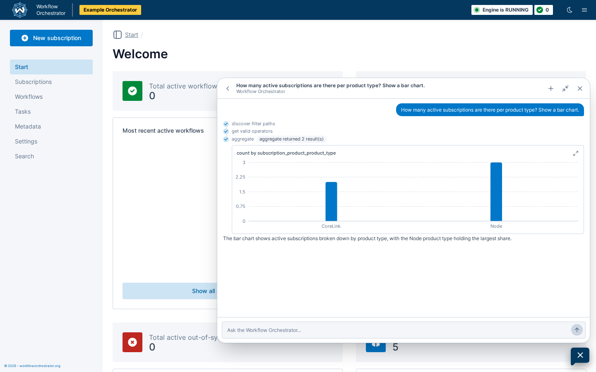

# Aggregate and charts <span class="wfo-protocol wfo-protocol--agui">AG-UI</span> { #aggregate-and-charts }

Turn a question about your inventory into counts and a chart. This example groups active subscriptions by product type, so you can compare service types at a glance. The following screenshot shows what this looks like in the chat popup on the WFO home page: the agent aggregates the active subscriptions and the popup draws the counts as a bar chart, one bar for the CoreLink and one for the Node product type.

<!-- use-case-capture -->
<div class="wfo-use-case-scene" markdown>

[](../../../img/orchestrator-agent/use-cases/aggregate-and-charts/scene.png)

</div>
<!-- /use-case-capture -->

This example uses the AG-UI popup's chart renderer. You can also ask for counts and grouped results in
[LibreChat](../../../orchestrator-agent/guides/librechat.md) or through the other
[client interfaces](../../../orchestrator-agent/reference/endpoints.md); chart presentation depends on the client.

## Try it yourself

```text
How many active subscriptions are there per product type? Show a bar chart.
```

1. Start the [example orchestrator and agent](../tutorials/example-orchestrator.md).
2. In the example stack, follow [the tutorial's WFO UI setup](../tutorials/example-orchestrator.md#part-4-explore-the-agent-inside-the-wfo-ui). For another portal, add the [agent chat popup](../../../orchestrator-agent/guides/chat-popup.md), configured against that agent. This example uses its AG-UI chart renderer.
3. Ask the question above in a new conversation. Compare the product labels and counts with the active subscriptions in WFO.

The result should include a chart backed by the returned aggregation data. Counts describe stored subscriptions, not live service health. A product with many active subscriptions is not necessarily carrying traffic.

Try grouping by lifecycle status instead, or narrow the question to one product. Keep the same filter when comparing the chart with a search or CSV. For your own setup, follow [getting started](../../../orchestrator-agent/getting-started.md) and add the chat popup to your own page or to the WFO UI.

## More examples

- [Find the underlying subscriptions](search.md)
- [Export a result set](export.md)
- [Ask across WFO and NetBox](multi-agent-netbox.md)
