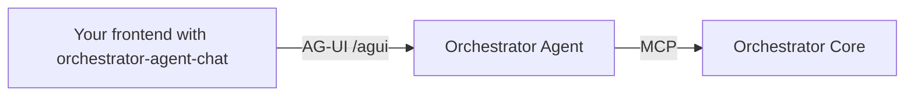

# Chat with the agent in your own frontend

AG-UI

<!-- OUTLINE: one paragraph. The problem: users work in your own portal or the WFO UI, not in LibreChat. The answer:
stream the agent into that frontend over AG-UI. -->

[orchestrator-agent-chat](https://github.com/workfloworchestrator/orchestrator-agent-chat) is a chat frontend for the
Orchestrator Agent that talks to it over [AG-UI](https://docs.ag-ui.com/).

!!! note "Work in progress"
    orchestrator-agent-chat is new and this page is an outline. The chat popup is being built in
    [orchestrator-agent#101](https://github.com/workfloworchestrator/orchestrator-agent/pull/101). This page will
    describe it once that is merged.

## What you get

<!-- OUTLINE:
- Answers stream in as they are written
- Search results and aggregations as tables and charts, from the structured events in the stream
- Follow-ups on the same thread, for example "export them" after a search
- An export as a download link
- Screenshot or short video of the chat (placeholder until recorded)
-->

## How it fits together

<!-- OUTLINE: diagram of the frontend -> POST /agui -> Orchestrator Agent -> MCP -> Orchestrator Core. Mention
that authentication uses the same bearer token as the rest of WFO. -->

## Chat popup

<!-- OUTLINE (after orchestrator-agent#101 is merged):
- What the popup is and where it appears
- How to add it to a page or to the WFO UI
- Configuration: agent URL, authentication, thread handling
- Screenshot
-->

## Limits

AG-UI runs the agent without the workflow form-fill skill, so this chat cannot start workflows. To start workflows
from chat, use LibreChat or an A2A planner, see
[Start workflows from chat](workflows-from-chat.md).

<!-- OUTLINE: revisit when the popup lands; check whether #101 changes this. -->

## Next steps

- [How-to: Build a frontend with AG-UI](../../../orchestrator-agent/guides/ag-ui.md)
- [Reference: Endpoints and protocols](../../../orchestrator-agent/reference/endpoints.md#ag-ui)
- [orchestrator-agent-chat on GitHub](https://github.com/workfloworchestrator/orchestrator-agent-chat)
