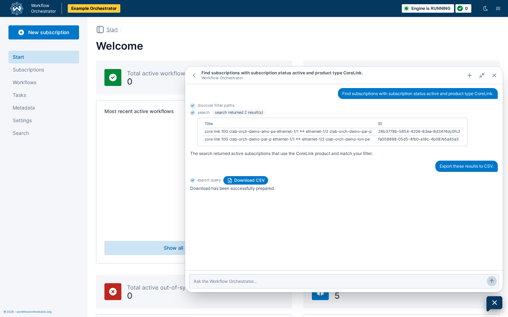

# Export results <span class="wfo-protocol wfo-protocol--agui">AG-UI</span> { #export-results }

Get a CSV you can inspect, share or use in another tool. The agent first finds the relevant subscriptions, then prepares an export of that query. The following screenshot shows what this looks like in the chat popup on the WFO home page: it lists the two active CoreLink subscriptions and, after the export request, offers a **Download CSV** button.

<!-- use-case-capture -->
<div class="wfo-use-case-scene" markdown>

[](../../../img/orchestrator-agent/use-cases/export/scene.png)

</div>
<!-- /use-case-capture -->

This example uses the AG-UI popup's built-in CSV download. The other interfaces can prepare an export, but they
currently do not deliver its download URL. Use AG-UI to download the file, as described in
[export delivery](../../../orchestrator-agent/reference/endpoints.md#export-delivery).

## Try it yourself

First ask:

```text
Find subscriptions with subscription status active and product type CoreLink.
```

Once the results appear, ask in the same thread:

```text
Export these results to CSV.
```

1. Start the [example orchestrator and agent](../tutorials/example-orchestrator.md).
2. In the example stack, follow [the tutorial's WFO UI setup](../tutorials/example-orchestrator.md#part-4-explore-the-agent-inside-the-wfo-ui). For another portal, add the [agent chat popup](../../../orchestrator-agent/guides/chat-popup.md) against your agent. This example uses its download control.
3. Ask the search question, then the export question, in one conversation.
4. Download the CSV and open it. Check the subscription IDs and row count against the search, allowing for a header row.

A message saying an export is prepared is not itself the downloaded file. Use the client’s download control and verify that it returns a CSV rather than an authentication error or an HTML page.

Try a different product or status filter. Check that the file contains only the intended records before sharing it. The [endpoint reference](../../../orchestrator-agent/reference/endpoints.md#ag-ui) explains the client connection.

## More examples

- [Choose what to export](search.md)
- [Summarise subscriptions in a chart](aggregate-and-charts.md)
- [Review a workflow before starting it](workflows-from-chat.md)
