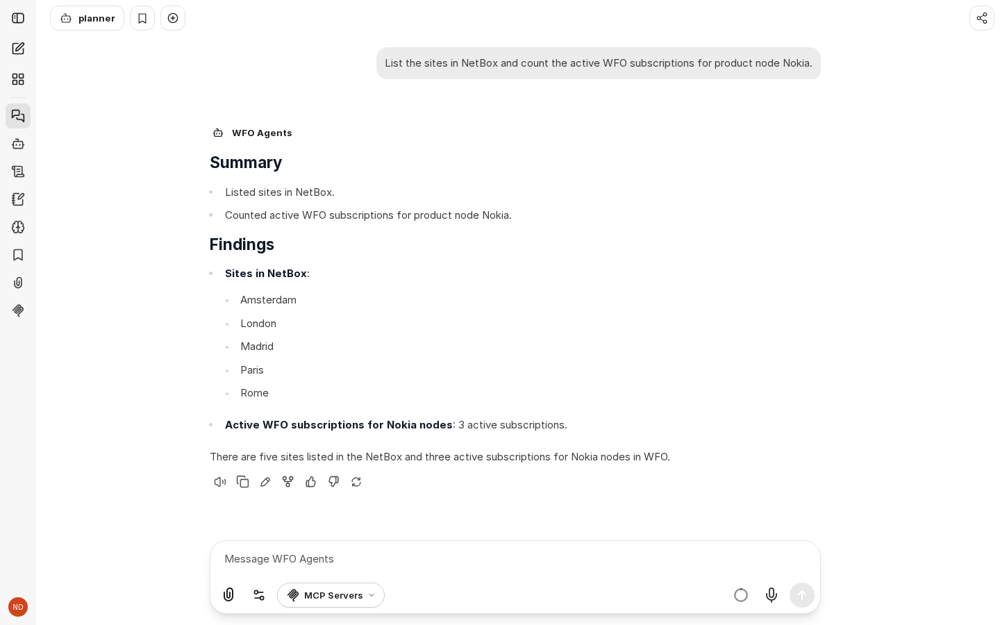

# Multi-agent: WFO + NetBox <span class="wfo-protocol wfo-protocol--a2a">A2A</span> { #multi-agent-wfo-netbox }

Ask one question that needs two systems. A planner asks the inventory agent about NetBox and the Orchestrator Agent about WFO, then combines their answers. The following screenshot shows what this looks like in LibreChat: the planner's answer with the five sites in NetBox and the three active WFO subscriptions for the Nokia node product.

<!-- use-case-capture -->
<div class="wfo-use-case-scene" markdown>

[](../../../img/orchestrator-agent/use-cases/multi-agent-netbox/result.png)

</div>
<!-- /use-case-capture -->

This example uses LibreChat to reach the planner through a chat gateway. The **A2A** pill refers to the planner's
delegation to the WFO and inventory agents. To use a different chat frontend, connect it to a gateway for the same
planner; see [connecting LibreChat to a planner](../../../orchestrator-agent/guides/librechat.md#next-steps).

## Try it yourself

```text
List the sites in NetBox and count the active WFO subscriptions for product node Nokia.
```

1. Follow the [example orchestrator tutorial](../tutorials/example-orchestrator.md), including the NetBox bootstrap and seeded WFO subscriptions.
2. Open LibreChat and select **planner**, rather than **wfo-search**.
3. Ask the question above. Check the site names in NetBox and the node count in WFO independently.

The answer should clearly distinguish NetBox inventory from WFO subscriptions. Neither source, on its own, proves that the devices or services are healthy.

For a practical NetBox example, watch [Monitoring-alert demo - from virge.io](https://virge.io/en/cases/wfo-monitoring-alert/){target="_blank" rel="noopener"}: it connects an interface alert with service and customer information, using inventory and live network evidence.

To add a system of your own, follow [Connect another system through a planner](../integrations/connect-service.md). Give the planner a question that genuinely needs both systems, and check each source separately.

## More examples

- [Investigate an outage yourself](outage-triage.md)
- [Trace an interface alert to a customer - from virge.io](https://virge.io/en/cases/wfo-monitoring-alert/){target="_blank" rel="noopener"}
- [Assess a maintenance window - from virge.io](https://virge.io/en/cases/wfo-maintenance-impact/){target="_blank" rel="noopener"}
