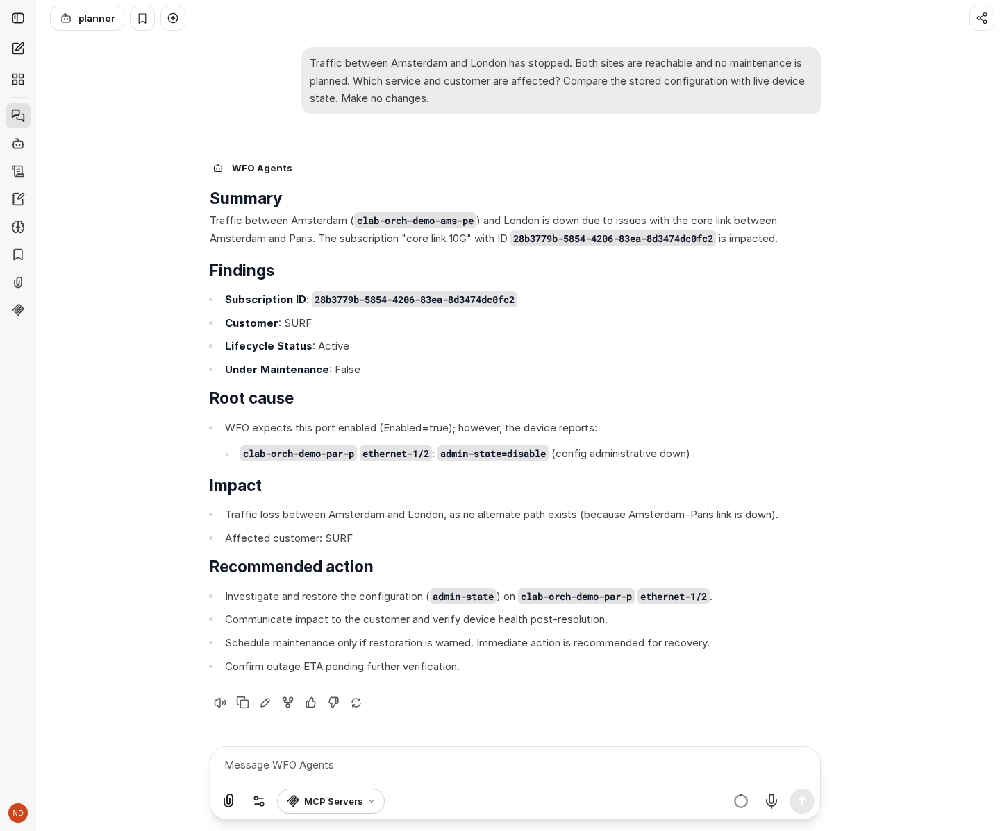

# Outage triage <span class="wfo-protocol wfo-protocol--a2a">A2A</span> { #outage-triage }

A customer reports an outage. Ask a planner to find the affected service and customer, compare the configuration in WFO with live device state, and explain what it found. The planner combines the Orchestrator Agent with specialists for NetBox inventory and the network devices. The following screenshot shows what this looks like in LibreChat: the planner's answer names the affected core link subscription and its customer, and the Paris interface that WFO expects enabled but the device reports administratively down, followed by recommended actions.

<!-- use-case-capture -->
<div class="wfo-use-case-scene" markdown>

[](../../../img/orchestrator-agent/use-cases/outage-triage/result.png)

</div>
<!-- /use-case-capture -->

This example uses LibreChat to reach the planner through a chat gateway. The **A2A** pill refers to delegation
between the planner and its specialist agents. Another chat frontend needs access to that planner and its inventory
and network tools; see [connecting LibreChat to a planner](../../../orchestrator-agent/guides/librechat.md#next-steps).

See the [recorded example - from virge.io](https://virge.io/en/cases/wfo-outage-triage/){target="_blank" rel="noopener"} for a short demonstration.

## Try it yourself

1. Follow the [network demo setup](https://github.com/workfloworchestrator/example-orchestrator/tree/main/demo#bring-it-up)
   in the example orchestrator, including its prerequisites. It adds an emulated three-node SR Linux network and a
   network agent to the base stack. The [introductory tutorial](../tutorials/example-orchestrator.md) explains the
   base agents if you are new to them.
2. From the example orchestrator directory, check the lab, then introduce a fault:

    ```shell
    uv run python demo/scripts/demo.py verify
    uv run python demo/scripts/demo.py impair down
    ```

3. Open [LibreChat](http://localhost:3080), select **planner**, and ask:

    ```text
    Traffic between Amsterdam and London has stopped. Both sites are reachable
    and no maintenance is planned. Which service and customer are affected?
    Compare the stored configuration with live device state. Make no changes.
    ```

The answer should identify the affected subscription and customer, and the Paris interface
`clab-orch-demo-par-p ethernet-1/2`: WFO expects it enabled, but the device reports it disabled. Check the
subscription and interface against the evidence in the answer. An active subscription alone does not prove that
traffic is flowing.

When finished, restore the lab yourself:

```shell
uv run python demo/scripts/demo.py impair clear
```

The investigation reads data; the fault and restore commands change your lab.

## More examples

Ask the planner *"What evidence would you need before estimating a restoration time?"* Then try the
[packet-loss or maintenance scenarios](https://github.com/workfloworchestrator/example-orchestrator/tree/main/demo#the-use-cases).
To use your own monitoring or network tools, follow
[Connect another system through a planner](../integrations/connect-service.md).

- [Combine WFO and NetBox](multi-agent-netbox.md)
- [Trace an interface alert - from virge.io](https://virge.io/en/cases/wfo-monitoring-alert/){target="_blank" rel="noopener"}
- [Find packet loss - from virge.io](https://virge.io/en/cases/wfo-packet-loss/){target="_blank" rel="noopener"}
