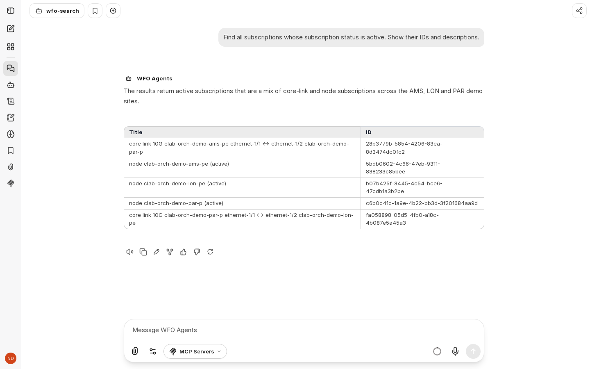

# Search subscriptions <span class="wfo-protocol wfo-protocol--chat">Chat</span> { #search-subscriptions }

Find services without remembering field names or writing a query. Ask the Orchestrator Agent a question in your own words and use the returned subscriptions to investigate further. The following screenshot shows what this looks like in LibreChat: a table with the title and ID of the five active subscriptions in the lab, three nodes and two core links.

<!-- use-case-capture -->
<div class="wfo-use-case-scene" markdown>

[](../../../img/orchestrator-agent/use-cases/search/result.png)

</div>
<!-- /use-case-capture -->

This example uses LibreChat through the agent's OpenAI-compatible chat interface. You can also search through the
AG-UI popup, another agent over A2A, or an MCP client; the client determines how results are displayed. See the
[client interfaces](../../../orchestrator-agent/reference/endpoints.md) for connection details.

## Try it yourself

```text
Find all subscriptions whose subscription status is active. Show their IDs and descriptions.
```

1. Complete the [example orchestrator tutorial](../tutorials/example-orchestrator.md), including its seeded data.
2. Open LibreChat and select **wfo-search**. Start a new conversation and ask the question above.
3. Check the returned subscription IDs against the orchestrator. Open a matching subscription and verify that its lifecycle status is active.

The useful result is a list of matching services, with enough identifiers to open the right subscription. The exact number depends on your lab data; a plausible description alone is not proof of a match.

Try asking for a particular product or a different subscription lifecycle status. Use the names in your own inventory. If nothing matches, check your seeded data and [search setup](../../../orchestrator-core/reference-docs/ai-search.md#running-it).

## More examples

- [Count and chart the results](aggregate-and-charts.md)
- [Download results as CSV](export.md)
- [Combine WFO and NetBox](multi-agent-netbox.md)
