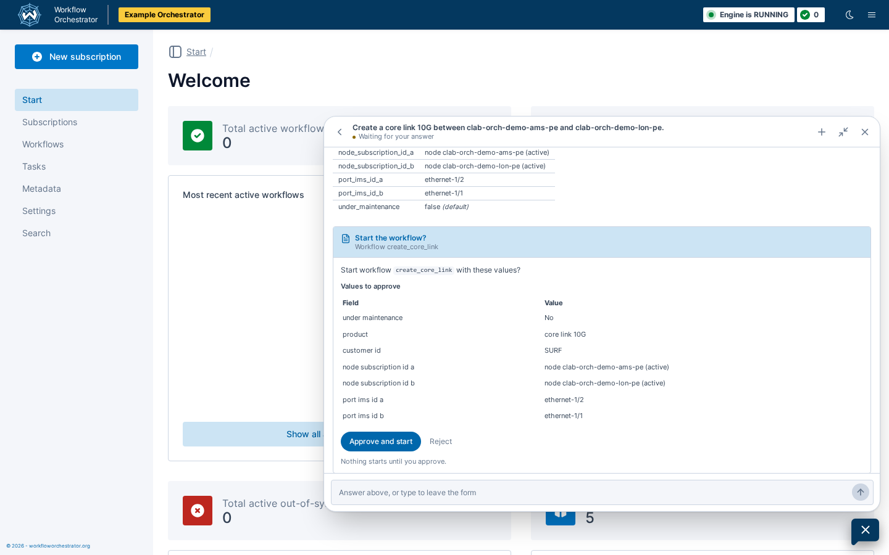

# Start workflows from chat <span class="wfo-protocol wfo-protocol--agui">AG-UI</span> { #start-workflows-from-chat }

Ask for a service change in plain language, then review the workflow before anything starts. The agent walks the form with Orchestrator Core; a person supplies the values and decides whether to approve. The following screenshot shows what this looks like in the chat popup at the end of the conversation: the values for the `create_core_link` workflow between the Amsterdam and London nodes, with **Approve and start** and **Reject** buttons and the note that nothing starts until approval.

<!-- use-case-capture -->
<div class="wfo-use-case-scene" markdown>

[](../../../img/orchestrator-agent/use-cases/workflows-from-chat/scene.png)

</div>
<!-- /use-case-capture -->

The example below uses the AG-UI chat popup. You can also request workflows, complete their forms and approve or
reject them through chat in [LibreChat](../../../orchestrator-agent/guides/librechat.md), connected directly to the
agent with workflow forms enabled.

## Try it yourself

To try this inside WFO, first enable [the tutorial's native chat popup](../tutorials/example-orchestrator.md#part-4-explore-the-agent-inside-the-wfo-ui).

```text
Create a core link 10G between clab-orch-demo-ams-pe and clab-orch-demo-lon-pe.
```

### What the user goes through

1. Start the [example orchestrator](../tutorials/example-orchestrator.md), including its seeded data.
2. Add the [agent chat popup](../../../orchestrator-agent/guides/chat-popup.md). Workflow forms over AG-UI need a
   client that supports interrupts, as the popup does; see
   [workflow interrupts](../../../orchestrator-agent/reference/endpoints.md#workflow-interrupts). To use LibreChat instead,
   [connect it directly to the agent](../../../orchestrator-agent/guides/librechat.md) with forms enabled.
3. Ask the question above. Choose the lab customer, endpoints, available ports and maintenance setting as the
   form asks. Orchestrator Core validates the answers; correct any values it rejects.
4. Stop at the final approval screen. Check the workflow name, customer, both endpoints and port values.
   **Awaiting approval** means the workflow has not started. Reject the request when you finish exploring.

Only approval of the pending form starts the workflow. Typing “yes” in ordinary chat does not approve it. If you
choose to approve a separate test later, check the returned process in WFO and follow any provisioning confirmation
steps there.

Try requesting a different workflow on disposable lab data. Keep the final review even when the request sounds
straightforward. The [workflow plugin reference](../../../orchestrator-agent/reference/plugins.md#workflow) explains
how workflow requests are handled, and [the approval explanation](../../../orchestrator-agent/explanation/index.md#the-agent-needs-approval-before-starting-workflows)
describes where the decision sits.

## More examples

- [Find the affected subscriptions](search.md)
- [Investigate an outage](outage-triage.md)
- [Assess maintenance impact - from virge.io](https://virge.io/en/cases/wfo-maintenance-impact/){target="_blank" rel="noopener"}
